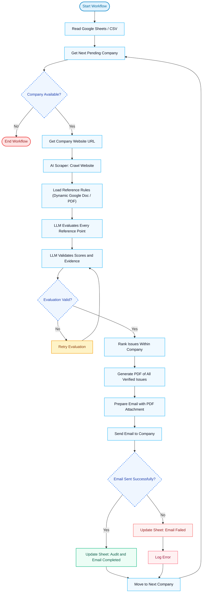

# LangGraph Website Automation & Audit Intelligence Pipeline

An enterprise-grade, autonomous website auditing pipeline engineered with **LangGraph**, **Google Docs Dynamic Rules Sync**, **PyMuPDF**, **Ollama (`llama3.2:1b`)**, and **ReportLab**. The workflow crawls target company websites across multiple pages, benchmarks them against dynamic evaluation criteria loaded directly from a live Google Doc link, evaluates findings with anti-hallucination verification, synthesizes publication-grade PDF reports, and delivers them via SMTP with duplicate outreach prevention.

---

## Workflow Diagram



---

## Key Pipeline Components

| # | Step / Node | Module | Description |
|---|---|---|---|
| 1 | **Read Google Sheets / CSV** | `nodes/read_companies.py` | Reads company leads from Google Sheets (if service account provided) or `data/companies.csv`. |
| 2 | **Select Next Company** | `nodes/select_company.py` | Picks the next company in the execution queue and initializes state variables. |
| 3 | **Scrape Website** | `nodes/scrape_website.py` | Crawls homepage and key subpages (`/about`, `/services`, etc.) using BeautifulSoup and requests; captures latency, headings, metadata, and body text. |
| 4 | **Load Reference Rules** | `nodes/load_reference_rules.py` | Synchronizes benchmark criteria dynamically from a live Google Doc URL. Automatically detects remote document changes via SHA-256 hashing, persists local cache, and supports PDF/rubric fallback. |
| 5 | **LLM Evaluates Website** | `nodes/evaluate_website.py` | Prompts local **Ollama (`llama3.2:1b`)** to evaluate the website against the 5 rubric pillars, assigning 1-10 scores and extracting verbatim quotes. |
| 6 | **Anti-Hallucination Corroborator** | `nodes/validate_evidence.py` | Cross-references LLM evidence quotes against raw scraped website text using exact and token-based fuzzy matching. |
| 7 | **Rank Verified Issues** | `nodes/rank_issues.py` | Sorts issues from weakest (lowest score = highest urgency) to strongest. |
| 8 | **Load Client-Specific Placeholders** | `nodes/load_placeholders.py` | Merges company name, contact, industry, date, scores, and agency branding. |
| 9 | **Generate Personalized Audit Content** | `nodes/generate_content.py` | Composes executive summary, tactical fixes, and outreach email copy. |
| 10 | **Generate PDF** | `nodes/generate_pdf.py` | Compiles publication-grade, styled PDF audit report using **ReportLab** with dynamic page numbering canvas. |
| 11 | **Email Report & Duplicate Guard** | `nodes/email_report.py` | Checks `data/sent_registry.json` cooldown to prevent duplicate outreach; sends email with PDF attachment via SMTP (or runs dry-run simulation). |
| 12 | **Update Status** | `nodes/update_status.py` | Writes updated audit status, report path, and timestamp back to CSV / Google Sheet and increments queue pointer. |
| 13 | **More Companies Remaining?** | `graph.py` | Conditional edge loops back to Node 2 if pending companies remain, or exits to `[END]`. |

---

## Dynamic Google Doc Benchmark Rules

The benchmark evaluation criteria are no longer limited to a static file. You can manage and update your evaluation rubric live in a Google Doc:

1. **Live Synchronisation**: Evaluates against the latest live content from your Google Doc link.
2. **Continuous Change Detection**: Computes SHA-256 hashes of the doc text on every run and each company cycle. If rules are modified in Google Docs, the pipeline detects the change, logs the update (`v1 -> v2`), and follows the revised rules immediately.
3. **Resilient Offline Caching**: Persists synced rules to `data/criteria_rules_cache.txt` and `data/criteria_rules_meta.json`. If network connectivity is lost, execution continues seamlessly using the cached rules.
4. **Fallback Rubric**: If no Google Doc URL is configured and no cache is present, falls back gracefully to `criteria_reference.pdf` (parsed via PyMuPDF) or built-in 5-pillar benchmark standards.

---

## Directory Structure

```
Langgraph_Website_Automation/
├── .env.example                       # Environment variables template
├── .gitignore                         # Git ignore patterns
├── config.py                          # Central configuration & paths
├── criteria_reference.pdf             # Standardized 5-pillar benchmark rubric PDF
├── graph.py                           # LangGraph StateGraph pipeline assembly
├── main.py                            # Main CLI execution entry point
├── requirements.txt                   # Python dependencies
├── setup_criteria_pdf.py              # Fallback PDF rubric generator
├── state.py                           # TypedDict state schema definitions
├── data/
│   ├── companies.csv                  # Target leads database
│   ├── criteria_reference_template.txt# Starter rubric text for Google Docs
│   └── sent_registry.json             # Duplicate guard outreach registry
├── nodes/
│   ├── __init__.py
│   ├── read_companies.py              # Node 1: CSV / Google Sheets loader
│   ├── select_company.py              # Node 2: Queue controller
│   ├── scrape_website.py              # Node 3: Multi-page web scraper
│   ├── load_reference_rules.py        # Node 4: Dynamic Google Doc synchronizer & change detector
│   ├── load_reference_pdf.py          # Node 4 backwards-compatibility proxy
│   ├── evaluate_website.py            # Node 5: Ollama llama3.2:1b evaluator
│   ├── validate_evidence.py           # Node 6: Anti-Hallucination Corroborator
│   ├── rank_issues.py                 # Node 7: Weakest -> Strongest ranker
│   ├── load_placeholders.py           # Node 8: Client placeholders injector
│   ├── generate_content.py            # Node 9: Executive narrative synthesizer
│   ├── generate_pdf.py                # Node 10: Publication-grade ReportLab PDF engine
│   ├── email_report.py                # Node 11: SMTP sender + Duplicate Guard
│   └── update_status.py               # Node 12: CSV / Sheet persistence updater
├── tests/
│   └── test_google_doc_rules.py       # Unit tests for URL parsing, change detection, and caching
└── reports/                           # Generated PDF audit reports
```

---

## Quick Start Guide

### 1. Install Dependencies
```bash
cd Langgraph_Website_Automation
pip install -r requirements.txt
```

### 2. Configure Environment & Google Doc Rules
Copy `.env.example` to `.env`:
```bash
cp .env.example .env
```

Add your Google Doc link to `.env`:
```env
GOOGLE_DOC_RULES_URL=https://docs.google.com/document/d/your-doc-id/edit?usp=sharing
```
*(Ensure the Google Doc sharing setting is set to "Anyone with the link can view").*

You can also pass the URL directly via CLI:
```bash
python main.py --doc-url "https://docs.google.com/document/d/your-doc-id/edit?usp=sharing"
```

### 3. Ollama Setup (Local LLM)
Make sure Ollama is installed and running with `llama3.2:1b`:
```bash
ollama run llama3.2:1b
```
*(If Ollama is offline, the pipeline automatically falls back to its built-in heuristic scoring engine without crashing).*

### 4. Run the Pipeline
```bash
python main.py
```

### 5. Inspect Results
- Check the generated PDF reports in the `reports/` folder.
- Inspect updated statuses and paths in `data/companies.csv`.
- Inspect outreach logs in `data/sent_registry.json`.
